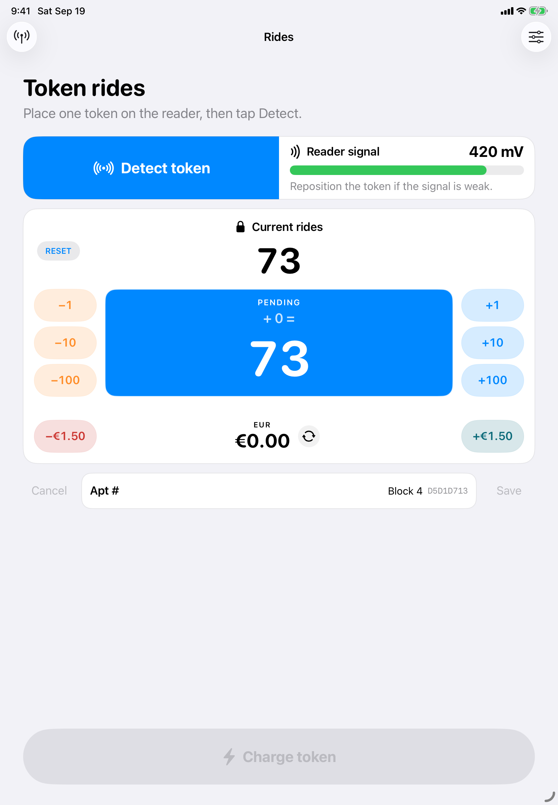
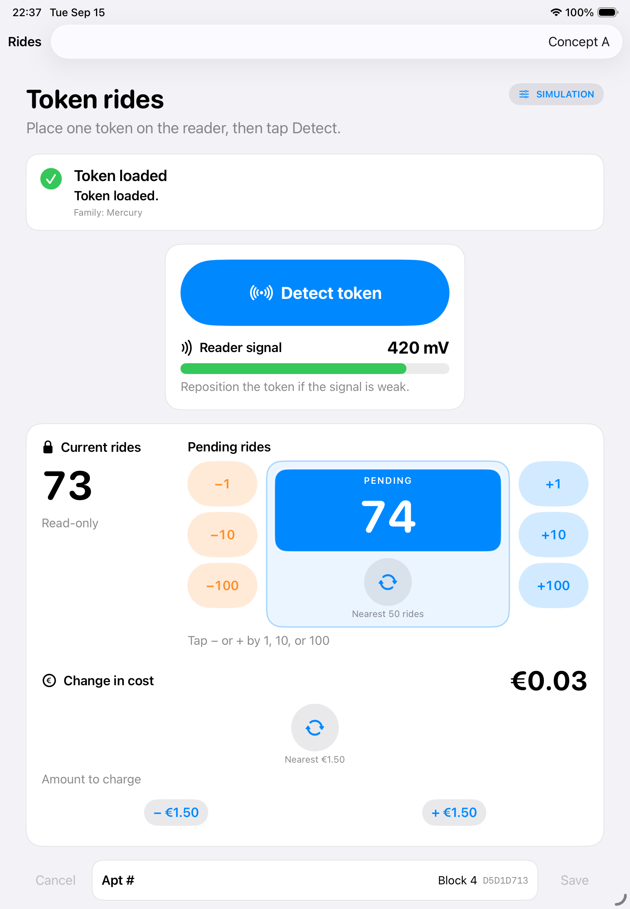
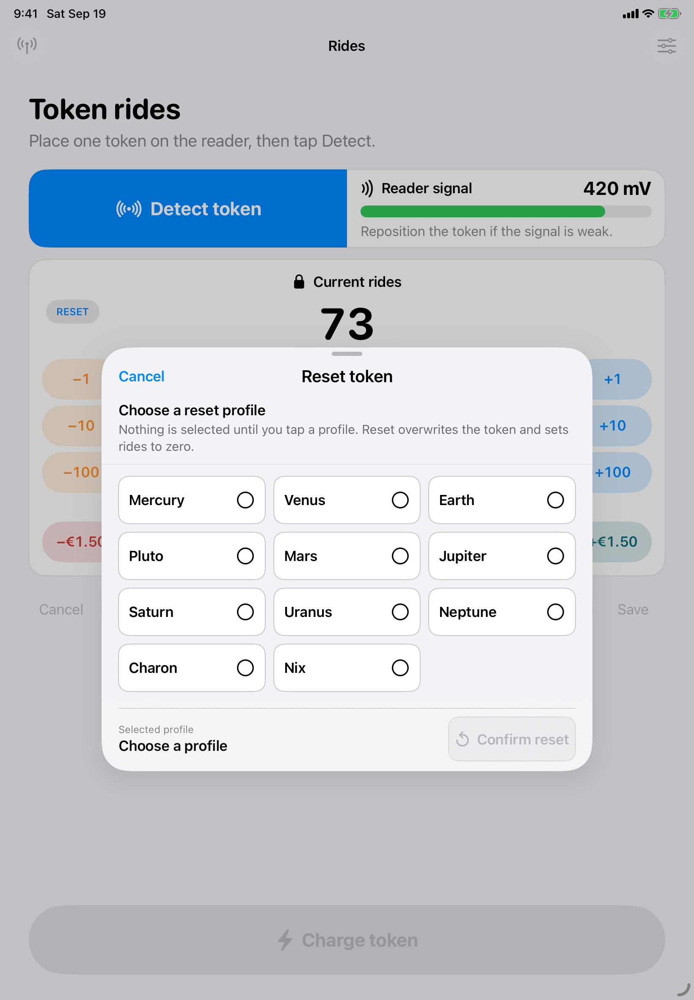
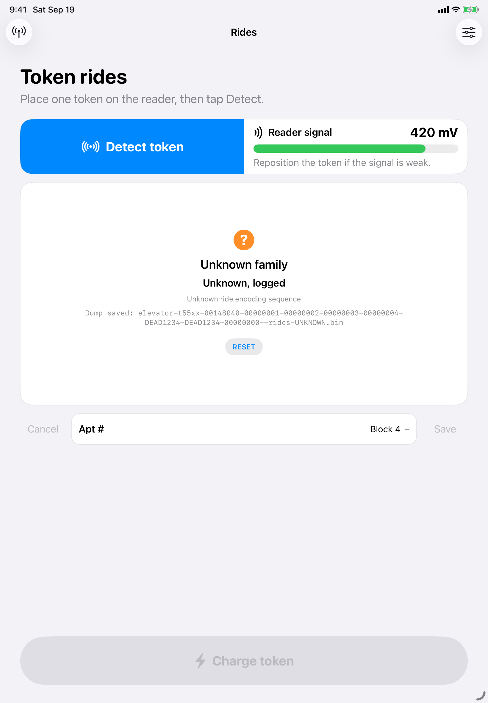
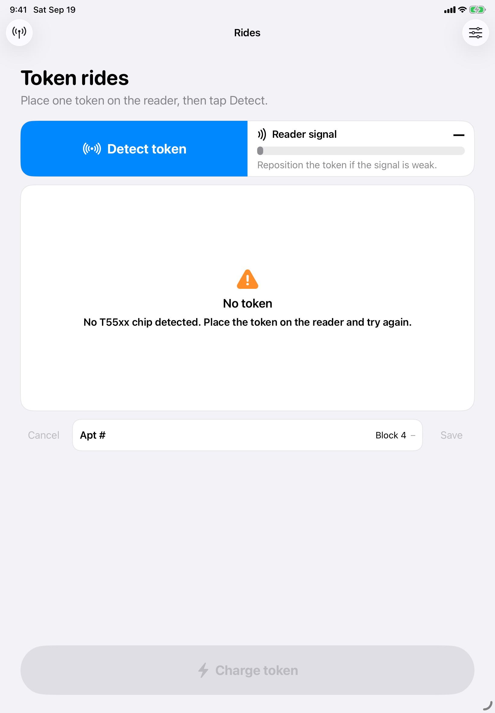

# RidesTablet

An iPad-only SwiftUI operator app for non-technical token operators. It targets iPad Air 4 and runs **Concept A** as the normal workflow: pair to a Mac `RidesBridge` over local Wi‑Fi/hotspot, then Detect / Charge / Reset through `NetworkRideTokenDevice`. A DEBUG-only fake reader keeps `FakeProxmark` available for deterministic UI work and simulator screenshots without a Mac or PM3.

## Operator flow

1. On first launch, complete bridge pairing (QR scan or manual URL + PIN) in the connection gate; later launches reconnect automatically when safe.
2. Calibrate once per app session: remove the token and tap **Calibrate: NO token**, then place it and tap **Calibrate: PLACE token**. The app checks the expected token presence at each step. Calibration sets the signal meter range with a margin. Then tap **Detect**; detect, tune, and read run as one flow. A fresh signal measurement remains visible even when no token is detected, so reposition and tap Detect again to compare.
3. On a known read, the merged panel shows Current rides, the noneditable **PENDING** total, and EUR. The three minus controls on the left and plus controls on the right adjust pending rides by 1, 10, and 100; values stay within 0–500.
4. The blue PENDING card shows the current count plus the signed change followed by `=` (for example, `180 + 150 =`; decreases use `180 − 20 =`). The change is priced at €0.03 per ride. EUR is adjusted with `−€1.50` / `+€1.50` buttons (50 whole rides). The × at the top-right of the blue PENDING card sets the pending total to zero; it does not change the token until **Charge token** is tapped. The round control on the EUR row rounds the signed delta to the nearest 50 rides (€1.50), with midpoints away from zero.
5. Tap **Charge token** only after a known token has changed. A successful write makes pending the new current count and adds a recent-charge entry with local time, ride-count equation, and actual EUR amount. Sequence metadata is retained in saved history but no longer shown as a table column. Tap its time for the full local date/time. History keeps the last 100 completed charges on this iPad across app launches. Single-line rows use aligned columns and full-width separators; Time and ride columns stay compact while EUR fills the remaining width and aligns at the right edge. The TOTAL row shows the number of saved charges, net rides added, and net EUR amount across that saved history. It is newest first and scrollable, below the reader in landscape or below ride counts in portrait.
6. `RESET` is in the merged panel for known and unknown tokens and requires an explicit profile selection. Every sequence resets to **0 rides**, including Mercury; both the token mirrors and the displayed count use zero. The confirmation button is disabled until a profile is selected. Idle, working, no-chip, and failure states replace the controls with centered status content; unknown saves report `Unknown, logged`, while log failures remain errors.

Portrait uses the seamless calibration/Detect and signal strip, centered Current → PENDING → EUR controls, and large Charge action. Landscape switches to a two-column reader and count/status layout, with Charge pinned below the right column. The unused Apt # / Cancel / Save row is hidden.

Connection diagnostics (Bonjour browse, manual URL, block-5 connectivity probe) live in the settings sheet and do not duplicate Concept A business logic.

## Automatic scanning

The reader strip has equal-width **Detect** and **Auto** controls joined by a vertical divider. Auto stays disabled until both calibration steps have completed. Detect stays blue; Auto has a neutral background and a straight right-hand divider against the signal panel. Auto toggles read-only polling on/off. Only its small diode changes state: hollow means off, yellow means a scan cycle is active, and green means enabled between cycles. The diode is 18 pt, with a soft glow reaching approximately 27 pt and quick, smooth color transitions. Auto matches Detect’s font size; button backgrounds and icons stay stable. Reduce Motion is respected. Pressing Detect stops/drains Auto and performs a single manual scan (or the initial calibration step if no token has yet been loaded and calibration has not been completed).

Signal probes target **100 ms start-to-start** while searching/positioning and **3 seconds** while a known or unknown token is confirmed present, never overlapping. Eight-sample PM3 probes now measure about **50.6 ms** after removing an unnecessary wait between tune-only commands; the RF-settling guard before real reads/writes remains intact. Full reads are still much slower (about 1.9 seconds in the original benchmark).

For an unconfirmed placement, Auto accumulates the entire eligible-signal episode. At least **five samples** are required, and their total spread must be within **5% of the calibration span** before reading. Earlier movement is not discarded by a sliding window. A **five-second fallback** arms when signal quality first reaches the better half; it remains armed through eligible movement but never bypasses the weak-signal cutoff. The sequence resets after detection attempts, degraded signal, stopping Auto, or calibration restart. Confirmed tokens still read only on significant worsening, not on a periodic timer. A successful weak-signal reread adopts the worse probe as its new baseline to avoid repeated reads; improvement alone does not trigger a read. Auto suppresses full reads in the weak/no-token end of its calibrated range: for the normal PM3 voltage direction it blocks the upper 15% and resumes below the upper 20% boundary. Hysteresis prevents chatter. Signal polling continues, blocked data cannot be charged, and the panel asks you to reposition the token. A fresh read is required before the pending controls return; matching snapshots retain their pending edits. Forced Detect bypasses this Auto-only voltage cutoff.

While positioning a new token, the panel shows **Hold token steady / Waiting for signal to settle…**; it changes to **Detecting…** and progress only when the full read begins. Existing known-token controls remain visible during a quality-check reread. Reads of the same unchanged block-4 / mirror snapshot preserve pending edits. Changed snapshots replace the loaded count; read-confirmed absence clears it. Repeated identical unknown snapshots do not repeatedly overwrite their dump. A failed full confirmation disables charging until a fresh confirmation succeeds.

The sliders icon at the far right of the reader strip restarts calibration. It stops Auto, clears the loaded/pending view and measured bounds, and returns to **Calibrate: NO token**, without writing to the token or deleting completed-charge history. The final calibration status is **Calibration complete**.

If Auto was enabled, Charge/Reset pauses and drains polling, performs the explicit mutation, refreshes with a full read after success, and resumes. No write is ever automatically retried. Auto stops when the screen disappears or the app leaves the active state; turn it on again after returning.

See [implementation, test receipts and remaining physical checks](../.docs/auto-detect-prototype-2026-10-17.md). The shared Xcode scheme includes simulator UI smoke tests. The opt-in physical UI test skips on Simulator and requires working iPad UI automation; ordinary simulator tests use only FakeProxmark, never PM3.

## Screenshots (Concept A, iPad Air 4 simulator)

The images below were captured on the **RidesTablet iPad Air 4** simulator using the DEBUG `FakeProxmark` path (`RIDES_SIMULATOR_FAKE_READER=1`). They show current Concept A operator UI, not the older diagnostic-only root or physical PM3 hardware.

| Scene | Caption |
| --- | --- |
|  | Known Mercury token after Detect — current rides, pending (unchanged), EUR, and reader signal. |
|  | Pending rides increased by 150 (`+ 150 =`) with matching EUR delta. |
|  | Reset sheet — profile grid with no selection until the operator taps one. |
|  | Unknown family after Detect — `Unknown, logged` and dump filename. |
|  | No-chip status when nothing is on the reader. |

### Simulator screenshot launch (DEBUG only)

For repeatable captures without tapping through the connection gate:

```sh
# Boot the agreed simulator (UDID from `xcrun simctl list`)
xcrun simctl boot "RidesTablet iPad Air 4"

# Build Debug, install, then launch with FakeProxmark auto-enabled.
# Use SIMCTL_CHILD_ prefix so simctl passes env vars into the app process.
SIMCTL_CHILD_RIDES_SIMULATOR_FAKE_READER=1 \
SIMCTL_CHILD_RIDES_SCREENSHOT_SCENE=known \
  xcrun simctl launch --terminate-running-process <UDID> com.example.RidesTablet
```

`RIDES_SCREENSHOT_SCENE` accepts `known`, `pending`, `history`, `reset`, `unknown`, and `no-chip` (alias `nochip`). Each scene runs Detect (and opens the reset sheet or adjusts pending where needed) before you capture with `xcrun simctl io <UDID> screenshot path.png`. `history` generates three fake charges in an isolated screenshot history store; it never writes a real token or adds demo entries to the operator history.

## Simulation scenarios (DEBUG fake reader only)

When the DEBUG fake reader is enabled, the top-right slider menu offers: Good token, Weak signal, No chip, Unknown family, and Write failure. Unknown family reports exactly `Unknown, logged` only after the page-0 dump saves successfully. If logging fails, it reports `Unknown token — log failed` with the save error. No chip reports exactly `No T55xx chip detected. Place the token on the reader and try again.`

Unknown page-0 images are written as 32-byte big-endian `.bin` files under the app's `Library/Application Support/RidesTablet/UnknownDumps` directory.

## Build and test

From the repository root, run the full XCTest suite:

```sh
xcodebuild test \
  -project RidesTablet/RidesTablet.xcodeproj \
  -scheme RidesTablet \
  -destination 'platform=iOS Simulator,name=RidesTablet iPad Air 4'
```

For a local UI review, launch the app on the same iPad Air (4th generation) simulator. Use the DEBUG fake reader (`RIDES_SIMULATOR_FAKE_READER=1` or the in-app **Use simulator fake reader** button) for offline UI work, or run `RidesBridge` on a Mac (`dotnet run --project RidesBridge/RidesBridge.csproj -- --fake-pm3`) for network integration testing.
